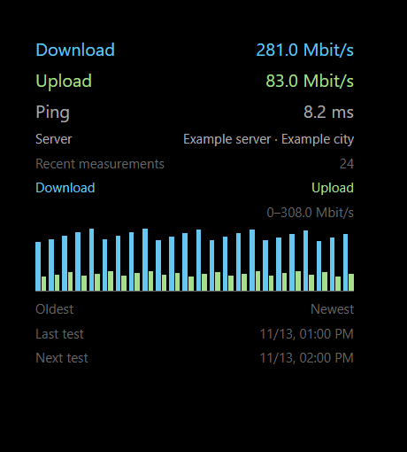

# MMM-Speedtest-BODK

## Description

A MagicMirror² module displaying download and upload speeds in Mbit/s, ping in milliseconds, and the actual test server name and location. Show numbers, a combined bar chart, or both. The compact chart retains the latest 24 successful measurements by default, with the oldest on the left. Each measurement pairs a blue download bar with a green upload bar on one automatic scale with a visible maximum. Hover over a pair for its time, both speeds and server. Upload bars can appear small when download speeds are much higher.

Measurements run on the device hosting the MagicMirror² server, not on a remote browser. Tests start on configuration/resume and repeat after the configured interval following completion. Multiple instances are serialized to prevent simultaneous bandwidth tests. History is in memory and resets on restart, suspension/resume or reconfiguration. Failed tests preserve previous results and retry at the normal interval.

Not yet validated on a Raspberry Pi.

### Preview

The [browser preview](docs/preview.html) shows the compact combined chart after 24 successful measurements using fictional data. Blue bars show download speed and green bars show upload speed on a shared scale, with the oldest measurement on the left. English is the default language. Open the file locally; no backend or speed test is started.



## Requirements

- MagicMirror² with Node.js 22 or newer supported by your MagicMirror² release.
- Internet access and the **official Ookla Speedtest CLI** installed separately for your OS and CPU architecture. The Python `speedtest-cli` is incompatible.
- Review Ookla's current terms and permitted use at the [official CLI page](https://www.speedtest.net/apps/cli). Install using its platform instructions; npm does not install this system program.

Run `speedtest` interactively as the same OS user running MagicMirror² and review/accept its license and privacy prompts before enabling the module. The module does not accept terms on your behalf. Verify `speedtest --format=json --progress=no` works for that user. If necessary, set an absolute `speedtestPath`.

## Installation

Run these commands on the device hosting MagicMirror²:

```sh
cd ~/MagicMirror/modules
git clone https://github.com/BravoOscarDK/MMM-Speedtest-BODK.git
cd MMM-Speedtest-BODK
npm install
```

There are no runtime npm dependencies. Install and initialize Ookla CLI separately as described above.

## Configuration

Add to the `modules` array in `~/MagicMirror/config/config.js`:

```js
{
  module: "MMM-Speedtest-BODK",
  position: "top_right",
  header: "Internet speed",
  config: {
    language: "en",
    updateInterval: 60 * 60 * 1000,
    historyLength: 24,
    showValues: true,
    showGraph: true
  }
},
```

| Option | Default | Description |
| --- | --- | --- |
| `language` | `"en"` | English or Danish; independent of global language |
| `updateInterval` | `3600000` | Delay in milliseconds after each test; integer 60000–2147483647 |
| `historyLength` | `24` | Number of successful results to retain; integer 1–168 |
| `showValues` | `true` | Download and upload numbers |
| `showGraph` | `true` | Combined download and upload history bar chart |
| `showPing` | `true` | Latest ping |
| `showServer` | `true` | Actual server name and location |
| `showLastUpdate` | `true` | Latest successful measurement time |
| `showNextTest` | `true` | Scheduled next test time; may wait for another instance |
| `serverId` | `""` | Automatic selection; set a numeric Ookla server ID to select one explicitly |
| `speedtestPath` | `"speedtest"` | Executable name or absolute path; no shell arguments |
| `testTimeout` | `120000` | Process timeout in milliseconds; integer 1000–600000 |
| `width` | `"360px"` | Module CSS width |
| `animationSpeed` | `300` | DOM transition duration in milliseconds |

Set `showValues: true, showGraph: false` for numbers only or `showValues: false, showGraph: true` for charts. Ping and server are controlled independently. Use `speedtest --servers` to discover available server IDs. Availability and automatic selection can change; the displayed server always comes from the completed test.

Twenty-four hourly measurements represent roughly one day; they are a count of measurements, not fixed hourly buckets. Tests take time and failures can leave gaps. Each speed test uses substantial bandwidth and can temporarily affect other traffic. Ethernet, Wi-Fi, CPU and server capacity can limit the observed result.

Override `--speedtest-download` and `--speedtest-upload` on `.MMM-Speedtest-BODK .speedtest-bodk` in `css/custom.css` to change graph colors.

## Language

English is the default. Set `language: "da"` for Danish. Regional codes such as `da-DK` are supported; unsupported languages, empty language values and missing translation keys fall back to English. Custom headers and upstream server names are preserved. Dates and numbers use the module locale without changing global state.

## Updating

Run these commands in the module directory:

```sh
cd ~/MagicMirror/modules/MMM-Speedtest-BODK
git pull --ff-only
npm install
```

Restart MagicMirror² using your normal startup method.

## Troubleshooting

- **Test failed:** read the MagicMirror² server log. Run the CLI command manually under the service user; verify license initialization, network access and server availability.
- **CLI not found:** install the official Ookla binary for the correct architecture and configure its absolute path if the service PATH differs from your terminal.
- **Invalid configuration:** check the ranges in the table; intervals are milliseconds.
- **Old numbers after a failure:** previous successful results remain visible with an error status. Failed tests are not inserted as zero-speed bars.
- **Changing servers:** automatic selection may choose a different server. Set `serverId` for more consistent comparisons.
- **Hidden module:** suspension cancels work; resuming starts a fresh history and test. Other instances continue independently.

## Validation

```sh
npm install
npm test
npm run check
```

Automated tests mock CLI execution and scheduling and exercise result conversion, configuration, localization and display. They do not measure an internet connection or validate Linux/Raspberry Pi hardware. Validate real CLI operation, service-user permissions and display on the target device before relying on results.

## License

MIT; see [LICENSE](LICENSE). Ookla Speedtest CLI is separate software subject to its own terms and is not bundled.
